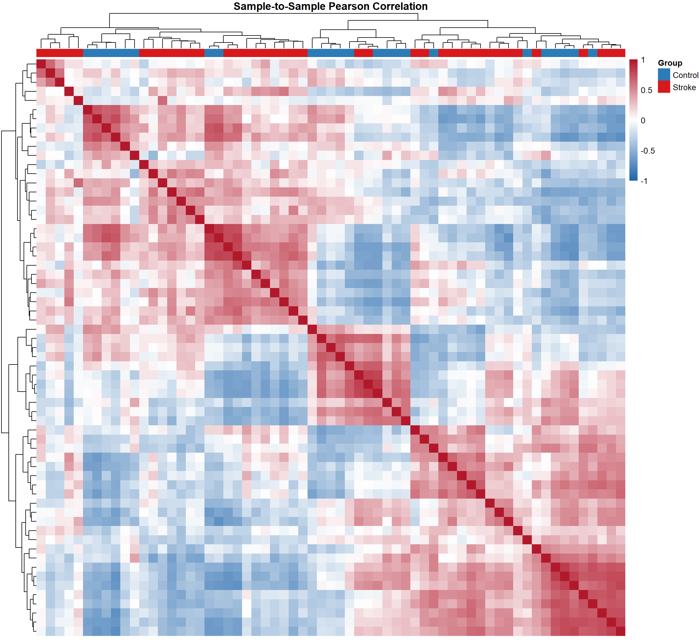
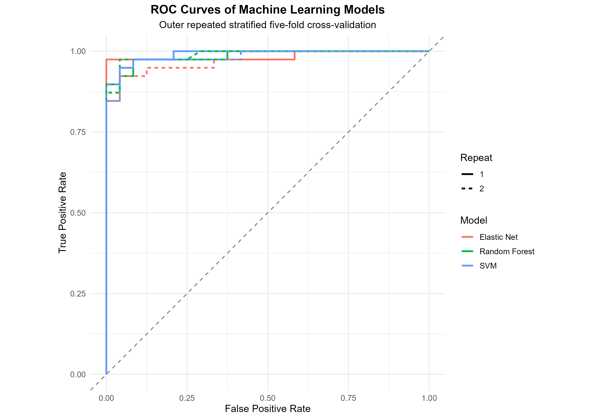

# Transcriptomic Biomarker Discovery and Machine Learning Classification in Acute Ischemic Stroke (GSE16561)

**Student:** K. Sukikaran  
**Registration number:** 2021/ASP/46  
**Programme:** BSc (Hons) Computer Science, University of Vavuniya  
**Project type:** Reproducible computational reanalysis of public transcriptomic data

## View the Full Analysis Report

The complete R Markdown analysis, including source code, statistical results, visualisations and machine-learning evaluation, is available as a published HTML report.

**[View the Full Bioinformatics Analysis Report](https://sukikaran.github.io/2021-ASP-46-stroke-transcriptomics-gse16561/)**

## Abstract

Acute ischemic stroke is associated with changes in gene expression in circulating blood cells. This project reanalyses the public Gene Expression Omnibus (GEO) dataset GSE16561 to identify genes and biological pathways associated with acute ischemic stroke and to evaluate whether blood gene-expression profiles can distinguish stroke cases from healthy controls. The dataset contains 63 whole-blood samples: 39 stroke samples and 24 healthy controls, measured using the Illumina HumanRef-8 v3.0 expression beadchip. After preprocessing and probe annotation, 17,494 unique genes were retained. Differential expression analysis using limma identified 2,779 genes at a Benjamini–Hochberg false discovery rate (FDR) below 0.05. Gene Ontology and KEGG enrichment analyses were performed, and Elastic Net logistic regression, radial-kernel Support Vector Machine and Random Forest classifiers were evaluated using nested repeated cross-validation. The results show substantial transcriptomic differences and promising internal classification performance, but the small sample size and absence of external validation mean that these findings are exploratory rather than evidence of clinical diagnostic readiness.

## 1. Introduction

Acute ischemic stroke results from interrupted blood flow to the brain and requires rapid diagnosis. Imaging remains central to diagnosis, while blood-based molecular measurements may provide complementary information about the biological response. Peripheral blood expression profiles can reflect changes in circulating immune and blood cells after an ischemic event.

This project reanalyses GSE16561 to identify genes and pathways associated with stroke and to evaluate whether selected expression features distinguish Stroke from Control samples. The hypothesis is that stroke is associated with measurable changes in peripheral blood expression. This is a reproducible reanalysis of a public dataset, not a claim of newly discovered biomarkers.

## 2. Dataset and data source

The data came from NCBI GEO Series GSE16561, *Gene expression analysis of peripheral whole blood RNA following ischemic stroke*, accessed using GEOquery [3]. GEO records 39 ischemic stroke samples and 24 healthy controls measured on the Illumina HumanRef-8 v3.0 beadchip (GPL6883) [1]. The associated study by Barr et al. investigated genomic biomarkers and pathways in ischemic stroke [2].

The Series Matrix contained 24,424 probes across 63 samples. Metadata were matched to expression columns by GEO sample accession and assigned to Stroke or Control. GEO's submitted expression values were already background-corrected, quantile-normalised and log2 summarised using RMA, so these transformations were not repeated. This project uses public, de-identified data and collected no new human samples.

## 3. Methods

### 3.1 Quality control, preprocessing and annotation

The matrix contained 24,427 missing values (1.587%). All 24,424 probes met the rule of no more than 20% missing values. Remaining missing cells were imputed with the probe-wise median. GPL6883 annotation mapped probe identifiers to gene symbols, and multiple probes per symbol were summarised with `limma::avereps()`. The final matrix contained 17,494 unique genes across 63 samples, with no missing values or duplicated symbols. Cleaned expression, metadata and QC summaries were exported to `data/`.

### 3.2 Exploratory data analysis

Boxplots and density plots were used to inspect expression distributions. PCA used the 500 most variable genes, and a sample-to-sample correlation matrix was displayed as an annotated heatmap. PCA scores, correlations and an EDA summary were exported.

### 3.3 Differential gene expression

Differential expression was tested with `limma`, using Control as the reference and a Stroke-versus-Control contrast. Gene-wise models were fitted with `lmFit()`, contrasted with `contrasts.fit()` and moderated using robust empirical Bayes (`eBayes(robust = TRUE)`) [4]. Benjamini–Hochberg adjusted p-values below 0.05 defined significance. Positive log-fold changes indicate higher expression in Stroke and negative values indicate lower expression.

### 3.4 Gene identifier mapping and functional enrichment

Gene symbols were mapped to Entrez IDs using `AnnotationDbi` and `org.Hs.eg.db`. `limma::goana()` tested Gene Ontology Biological Process, Molecular Function and Cellular Component categories; `limma::kegga()` tested KEGG pathways [4]. Biological Process and KEGG tests were also performed separately for up- and downregulated genes. Benjamini–Hochberg FDR below 0.05 defined enriched terms.

### 3.5 Machine-learning model development and evaluation

The classifiers were Elastic Net logistic regression (`glmnet`) [5], radial-kernel SVM (`e1071`) [7] and Random Forest (`randomForest`) [6]. Nested cross-validation used two repeats of stratified five-fold outer validation, with stratified three-fold inner tuning. Candidate feature counts were 10 and 20. Limma ranking and feature selection were conducted inside training folds, and SVM scaling parameters were estimated from training data only. Model selection used mean inner-fold ROC-AUC. The grids varied alpha/lambda for Elastic Net, cost/gamma for SVM, and mtry fraction/node size for a 300-tree Random Forest. Accuracy, sensitivity, specificity, precision, F1-score and ROC-AUC were calculated per model and repeat, then summarised across repeats. Each model's 126 predictions are repeated predictions for the same 63 samples, not 126 independent participants.

## 4. Results

### 4.1 Preprocessing and exploratory analysis

The final matrix contained 17,494 genes and 63 samples. Mean expression was -0.0109 (SD 0.3817). PC1 and PC2 explained 48.12% and 15.06% of variance, respectively (63.18% combined), but the PCA showed overlap between groups. Sample correlations ranged from -0.7218 to 0.8515 (mean 0.0047), and the heatmap did not show perfectly group-specific clusters. EDA alone therefore did not clearly separate Stroke from Control.

**Figure 1.** Expression distributions across samples.  


**Figure 2.** Density distributions of gene expression across samples.  


**Figure 3.** PCA of the 500 most variable genes.  


**Figure 4.** Sample-to-sample correlation heatmap with group annotations.  


### 4.2 Differentially expressed genes

Limma tested 17,494 genes. At FDR below 0.05, 2,779 were significant: 1,443 upregulated and 1,336 downregulated in Stroke; 14,715 were not significant. ANTXR2 ranked first (log2 fold change 0.8183; p = 5.80 × 10⁻¹⁵; adjusted p = 1.01 × 10⁻¹⁰). Other highly ranked genes included LAMP2, CTSS, RGS2, PLXDC2 and DOCK8. These associations do not validate individual genes as diagnostic markers.

**Figure 5.** Volcano plot of the Stroke-versus-Control differential expression results.  


### 4.3 Gene mapping and enrichment

Of the 17,494 tested symbols, 16,679 mapped to unique Entrez IDs, 812 were unmapped and three were ambiguous. A total of 2,640 significant DEGs had Entrez IDs (1,373 upregulated; 1,267 downregulated).

Eight enrichment analyses completed. For all DEGs, GO returned 15,196 Biological Process terms (675 significant), 4,929 Molecular Function terms (51 significant) and 1,970 Cellular Component terms (142 significant). Upregulated and downregulated Biological Process sets had 995 and 176 significant terms, respectively. KEGG returned 373 pathways per analysis: 81 significant for all DEGs, 117 for upregulated genes and 17 for downregulated genes.

The findings included immune and innate-defence themes among upregulated genes and metabolic, RNA-processing, translation and ribosome-related themes among downregulated genes. KEGG results included phagosome, lysosome, lipid/atherosclerosis, neutrophil extracellular trap formation and ribosome pathways. Enrichment measures over-representation; it does not prove pathway activation, inhibition or causality.

**Figure 6.** GO Biological Process enrichment for all significant DEGs.  


**Figure 7.** GO Molecular Function enrichment for all significant DEGs.  


**Figure 8.** GO Cellular Component enrichment for all significant DEGs.  


**Figure 9.** GO Biological Process enrichment for upregulated DEGs.  


**Figure 10.** GO Biological Process enrichment for downregulated DEGs.  


**Figure 11.** KEGG pathway enrichment for all significant DEGs.  


**Figure 12.** KEGG pathway enrichment for upregulated DEGs.  


**Figure 13.** KEGG pathway enrichment for downregulated DEGs.  


### 4.4 Machine-learning performance

The nested cross-validation procedure generated 378 outer validation predictions across the three models and two repeats. Each model contributed 126 predictions. Elastic Net achieved the highest mean accuracy (0.9524), sensitivity (0.9359), specificity (0.9792), precision (0.9865) and F1-score (0.9605). Random Forest achieved the highest mean ROC-AUC (0.9869), closely followed by SVM (0.9866) and Elastic Net (0.9797). The performance estimates are summarised below.

| Model | Accuracy | Sensitivity | Specificity | Precision | F1-score | ROC-AUC |
|---|---:|---:|---:|---:|---:|---:|
| Elastic Net | 0.9524 | 0.9359 | 0.9792 | 0.9865 | 0.9605 | 0.9797 |
| Random Forest | 0.9286 | 0.9103 | 0.9583 | 0.9726 | 0.9404 | 0.9869 |
| SVM (radial) | 0.9365 | 0.9231 | 0.9583 | 0.9730 | 0.9474 | 0.9866 |

The results show high internal discrimination in this dataset, although the relative ranking depends on the metric: Elastic Net had the strongest threshold-based metrics, while Random Forest had the highest mean ROC-AUC. The two-repeat validation provides an internal estimate only. It does not establish that the models will perform similarly in a new hospital, population, platform or clinical setting.

**Figure 14.** ROC curves from the outer cross-validation predictions.  


## 5. Discussion

The DEG and enrichment findings are consistent with blood-cell and immune changes associated with acute stroke, while the overlapping EDA patterns show that group differences are not completely separated in unsupervised space. The limma model included group only; age, sex, vascular risk factors, medication and sampling time were not included as covariates. The observed associations may therefore be affected by unadjusted sample characteristics and should not be interpreted as causal.

The classifiers were evaluated on only 63 samples, with healthy controls rather than stroke mimics or other neurological conditions. Validation was internal, used only two repeats of five-fold cross-validation and did not include an independent cohort. In addition, missing-value imputation was performed during initial preprocessing before cross-validation. Although only 1.587% of values were missing, imputation within each training fold would provide a stricter leakage-controlled estimate. The models are therefore exploratory and are not clinically validated diagnostic tests. Further work should use larger, diverse cohorts, relevant clinical control groups, covariate adjustment, fold-wise preprocessing and external prospective validation.

## 6. Conclusion and future work

The project reanalysed GSE16561 from preprocessing through differential expression, enrichment and machine-learning evaluation. It identified 2,779 significant DEGs and GO/KEGG enrichment patterns, while nested cross-validation showed strong internal classification metrics. These results support stroke-associated expression differences in this dataset, but do not establish causality or clinical diagnostic performance. Independent validation, clinical covariates, stroke-mimic controls and fold-wise preprocessing are important next steps.

## 7. Reproducibility and project structure

The analysis was written in R Markdown and rendered to HTML. The report records R 4.4.2 and key package versions: GEOquery 2.74.0, limma 3.62.2, ggplot2 4.0.3, pheatmap 1.0.13, AnnotationDbi 1.68.0, org.Hs.eg.db 3.20.0, glmnet 4.1-10, e1071 1.7-17 and randomForest 4.7-1.2.

Expected repository structure:

```text
stroke-transcriptomics-gse16561/
├── README.md
├── code/
│   ├── stroke_biomarker_analysis.Rmd
│   ├── stroke_biomarker_analysis.html
│   └── R/
│       ├── 00_packages.R
│       ├── 01_data_acquisition.R
│       ├── 02_preprocessing_annotation.R
│       ├── 03_exploratory_analysis.R
│       ├── 04_differential_expression.R
│       ├── 05_gene_enrichment.R
│       ├── 06_machine_learning.R
│       └── 07_reproducibility.R
├── data/
├── docs/
│   └── index.html
├── figures/
└── stroke-transcriptomics-gse16561.Rproj
```

The analysis code is organised into labelled workflow scripts in `code/R/`. The R Markdown entry point registers these chunks with `knitr::read_chunk()` and executes them in sequence, keeping the code visible in the rendered report. Knit `code/stroke_biomarker_analysis.Rmd` as the entry point rather than sourcing the numbered scripts individually.

To reproduce the analysis, clone the repository, open `stroke-transcriptomics-gse16561.Rproj` in RStudio, and knit `code/stroke_biomarker_analysis.Rmd` from beginning to end. Install required packages when prompted. The script locates the project folders, loads or retrieves GEO data and platform annotation, runs the analyses, and exports outputs to `data/` and `figures/`. The committed `sessionInfo()` records the software environment used for the submitted report. Raw caches and large intermediate files are excluded through `.gitignore`; CSV results and figures are retained.

## 8. References

1. Barrett, T., Wilhite, S. E., Ledoux, P., et al. (2013). NCBI GEO: archive for functional genomics data sets—update. *Nucleic Acids Research*, 41(D1), D991–D995. https://doi.org/10.1093/nar/gks1193.
2. Barr, T. L., Conley, Y., Ding, J., et al. (2010). Genomic biomarkers and cellular pathways of ischemic stroke by RNA gene expression profiling. *Neurology*, 75(11), 1009–1014. https://doi.org/10.1212/WNL.0b013e3181f2b37f.
3. Davis, S., & Meltzer, P. S. (2007). GEOquery: a bridge between the Gene Expression Omnibus (GEO) and BioConductor. *Bioinformatics*, 23(14), 1846–1847. https://doi.org/10.1093/bioinformatics/btm254.
4. Ritchie, M. E., Phipson, B., Wu, D., et al. (2015). limma powers differential expression analyses for RNA-sequencing and microarray studies. *Nucleic Acids Research*, 43(7), e47. https://doi.org/10.1093/nar/gkv007.
5. Friedman, J., Hastie, T., & Tibshirani, R. (2010). Regularization paths for generalized linear models via coordinate descent. *Journal of Statistical Software*, 33(1), 1–22. https://doi.org/10.18637/jss.v033.i01.
6. Breiman, L. (2001). Random forests. *Machine Learning*, 45, 5–32. https://doi.org/10.1023/A:1010933404324.
7. Chang, C.-C., & Lin, C.-J. (2011). LIBSVM: A library for support vector machines. *ACM Transactions on Intelligent Systems and Technology*, 2(3), 27. https://doi.org/10.1145/1961189.1961199.
8. R Core Team. (2024). *R: A language and environment for statistical computing*. R Foundation for Statistical Computing, Vienna, Austria. https://www.R-project.org/.